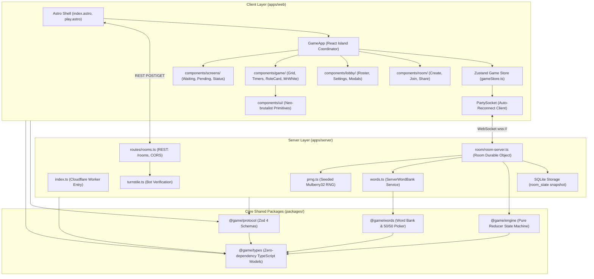
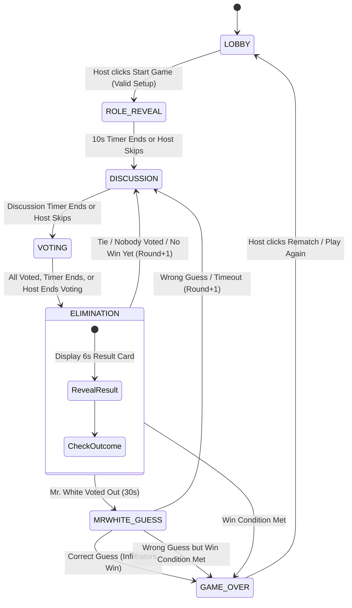

# Architecture & Monorepo Map

## System Architecture



## Monorepo Directory Structure

```
undercover/
├── apps/
│   ├── web/                          # Astro 7 + React 19 client island
│   │   ├── src/
│   │   │   ├── components/           # room/, lobby/, game/, screens/, ui/, GameApp.tsx
│   │   │   ├── lib/                  # REST API helpers, avatar renderer, storage
│   │   │   ├── pages/                # index.astro (landing/SEO), play.astro (SPA shell)
│   │   │   ├── stores/               # gameStore.ts (Zustand reactive game state)
│   │   │   └── styles/               # global.css (Tailwind v4 design tokens)
│   │   ├── astro.config.mjs
│   │   ├── vercel.json               # /r/:code rewrite to /play, CSP & headers
│   │   └── package.json
│   │
│   └── server/                       # Cloudflare Workers + PartyServer Durable Objects
│       ├── src/
│       │   ├── room/                 # room-server.ts (Room Durable Object with SQLite)
│       │   ├── routes/               # rooms.ts (POST /rooms, GET /rooms/:code, CORS)
│       │   ├── index.ts              # Worker fetch handler & PartyServer request router
│       │   ├── prng.ts               # Seeded Mulberry32 PRNG
│       │   ├── storage.ts            # SQLite state snapshot adapter
│       │   ├── turnstile.ts          # Cloudflare Turnstile validation
│       │   ├── utils.ts              # Room codes, token hashing, ID generators
│       │   └── words.ts              # ServerWordBank service
│       ├── wrangler.jsonc
│       └── package.json
│
├── packages/
│   ├── engine/                       # Pure game state machine (zero I/O, deterministic)
│   │   └── src/                      # rules/, state/, view/, reduce.ts
│   ├── protocol/                     # Zod 4 schemas for messages, models, and views
│   ├── types/                        # TypeScript types, enums, models, views
│   └── words/                        # Curated word pairs (server only, never sent to web)
│
├── tests/                            # e2e/, engine/, protocol/, server/, words/
├── scripts/
│   └── check-boundaries.ts           # Verifies web never imports @game/words
├── package.json                      # Monorepo workspaces and root scripts
└── tsconfig.base.json
```

## Package Dependency Boundaries

- **`packages/words` is strictly server-only.** Word lists and pairings are never imported into `apps/web`; clients only ever receive their single assigned word.
- **`bun run check:boundaries`** scans client code to guarantee no accidental `@game/words` imports.
- **`packages/engine` is zero I/O.** No `Date.now()`, `Math.random()`, or network/database calls — timestamps, PRNGs, IDs, and the word bank are injected via `EngineContext`.

## Core Game Engine & State Machine

### Pure Reducer Design

```ts
reduce(
  state: Room,
  action: ReducerAction,
  ctx: EngineContext // { now: number, rng: () => number, words: WordBank, newId: () => string }
): {
  state: Room;
  error?: string;
  effects: EngineEffect[];
  alarmAt: number | null;
}
```

The server hydrates state from SQLite, passes the incoming action into `reduce()`, saves the result, runs any side effects, and schedules the next deadline via the Durable Object alarm system (`alarmAt`).

### Phase State Machine



## Session Lifecycle & Reconnection

PartySocket auto-reconnects with exponential backoff and probes immediately on tab foreground. Lobby disconnects are held for 15 s; in-game disconnects are marked `away` and keep their seat until the round's vote concludes. If the host disconnects, host authority transfers to the earliest-joined connected player after 15 s.

## Related Documentation

- [`@game/engine` Package Documentation](../packages/engine/README.md)
- [Real-Time Protocol & Messages](./protocol.md)
- [Security, Anti-Cheat & Privacy](./security.md)
